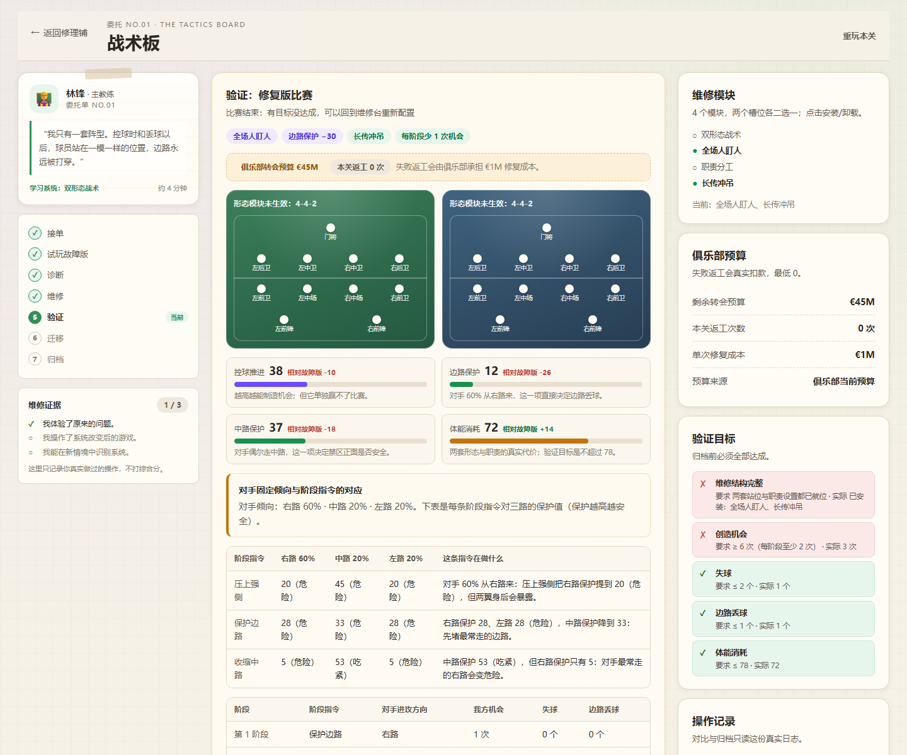
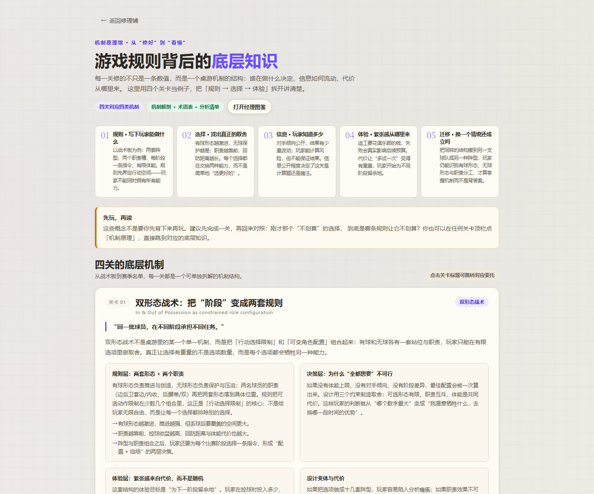
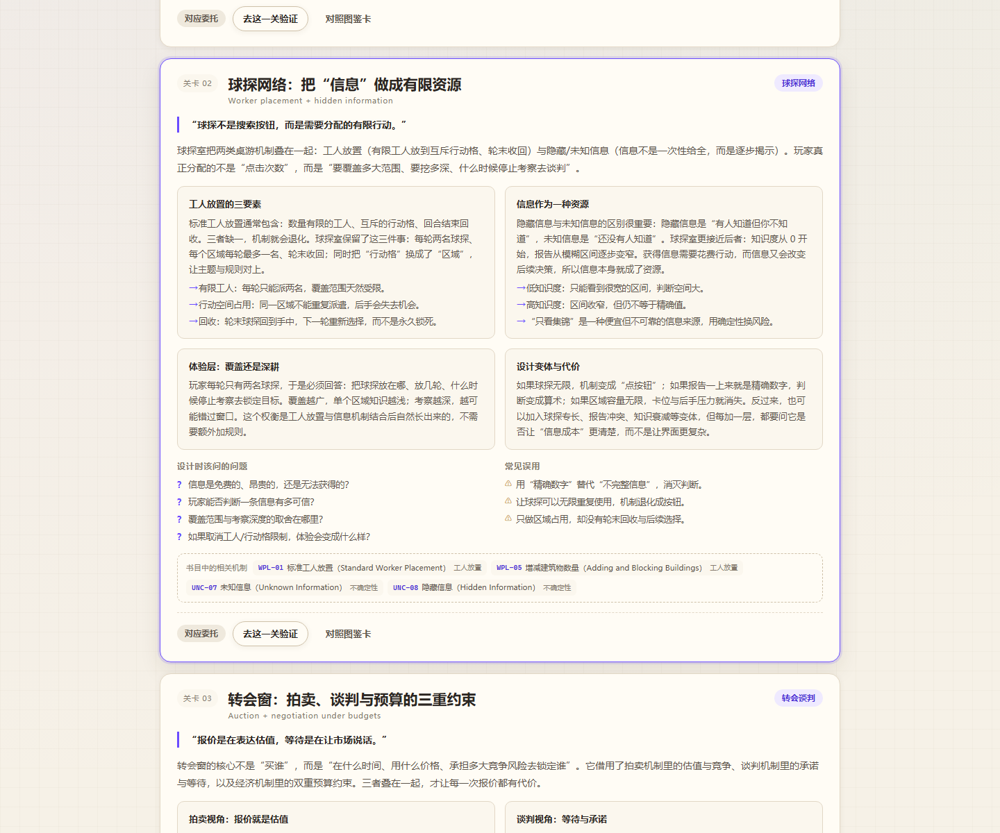

# 足球经理修理铺

> 修好四个坏系统，看懂每个选择。

**在线试玩：** https://gotoanywhere2021.github.io/manager-repair-shop/
**GitHub 仓库：** https://github.com/gotoanywhere2021/manager-repair-shop

[](https://github.com/gotoanywhere2021/manager-repair-shop/actions/workflows/ci.yml)
[](LICENSE)

一个可以直接在浏览器里玩的足球经理教学游戏。你扮演俱乐部系统修理工：先试玩坏掉的战术、球探、转会与注册，再亲手装上能跑起来的规则；用比赛记录、球探报告和注册名单，看清每个选择从哪里来、又要付出什么。

- 技术栈：React 19 + TypeScript + Vite，Vitest 做规则测试。
- 无后端、无付费 API、无密钥、无外部图片 CDN；进度保存在浏览器 localStorage。
- **非官方作品**：灵感来自足球经理类游戏的公开功能介绍，不使用真实俱乐部、球员或教练名称，数值为原创简化原型，与 Sports Interactive、Sega 或《Football Manager》系列无隶属关系。
- 四关共用一个虚构俱乐部「北港联」的赛季：每关完成后的真实结果会写入主页的俱乐部办公室时间线。
- **纯 CSS 3D 视觉层**：首页桌面球场、每关 3D 视窗（球场 / 地球 / 硬币 / 卡扇）、3D 资源仪表与卡片倾斜；无 WebGL、无 three.js、无外部图片。
- 维修不再是唯一正确路径：每关有「正确模块 + 有副作用的错误模块」组成的模块池，允许装错、验证失败、回到维修台重试。

---

## 本轮更新（v5.2.0）

- **首页 3D 桌面球场**：用 CSS `perspective` 做了一张斜放的球台，球员棋子、球场线、木制底座与三张浮动数据卡同时呈现；无 WebGL、无 three.js、无外部图片。
- **每关 3D 可视化视窗**：战术板的斜放球场、球探室的旋转地球、转会窗的 3D 硬币与报价卡、赛季名单的 3D 卡扇与注册环；全部是纯 CSS。
- **数据化仪表**：俱乐部办公室的转会预算/周薪空间/返工次数改成有厚度和渐变的 3D 条，不再是纯文字。
- **交互深度**：委托卡与图鉴卡在悬停时有轻微 3D 倾斜；`prefers-reduced-motion` 下停止漂浮、旋转与脉冲动画。
- **移动端**：390px 下收起部分装饰卡、缩小场景，页面无横向滚动。
- **测试**：210 → 211 个测试，新增 3D 视觉层渲染断言。

## 本轮更新（v5.1.0）

- 游戏名改为 **《足球经理修理铺》**。
- 主标语改为「修好四个坏系统，看懂每个选择。」；首屏说明改成更具体的动作与结果，不再用「不好玩/有选择」这类抽象对比。
- 浏览器标题、分享描述、展示模式口播、README 与机制导读同步更新。

## 本轮改进（v5.0.0）

- **新增「机制原理馆」**：把四关背后的桌游机制讲清楚——行动选取与限制、工人放置、拍卖与谈判、成套收集；包含四关机制专题、十节基础课、机制解剖、术语表、分析清单与书目引用。
- **关卡内直达**：每关顶栏「机制原理」会跳到本关对应的底层知识；经理图鉴每张卡的「底层机制」入口也会跳转。
- **原创概括 + 书目引用**：参考《桌面游戏设计的基石：机制百科全书》（Geoffrey Engelstein、Isaac Shalev）的机制分类与分析方式，用原创中文重新解释，不复制原文/图表，不标页码。
- **导读文档**：`docs/mechanism-primer.md` 提供课外的完整文字版；游戏内可按需查阅。
- **测试**：202 → 210 个测试，新增机制原理内容完整性与入口流程覆盖。

## 本轮改进（v4.0.0）

- **拿掉答案提示**：不再给模块贴「推荐 / 有副作用 / 错误模块」标签，不再提供「推荐组合」快捷按钮；玩家要自己看效果与副作用做判断。
- **失败真的疼**：每次返工俱乐部承担真实成本（战术板 €1M / 球探室 €0.5M+维护费 / 转会窗与名单 €1M），从转会预算扣除并累计返工次数，主页可见。
- **俱乐部真正跨关连续**：战术板产出会进入赛季名单的战术阶段；球探室产出候选报告；转会窗使用俱乐部剩余预算并产出真实签约；赛季名单把跨关引援计入 25 人名单与注册校验，最后提交真实赛季报告。
- **数据可见**：主页俱乐部办公室显示剩余转会预算、周薪空间、已签人数、返工次数，以及跨关产出（战术板配置 / 球探报告 / 已签约球员）。
- **测试**：171 → 202 个测试，新增无答案提示、返工扣款、clubPatch 跨关合并、跨关引援计入注册、球探候选进入转会窗等覆盖。



## 本轮改进（v3.0.0）

- **俱乐部办公室**：四关共享「北港联 2026/27 赛季」，每次完成写入真实比赛、球探、转会或注册结果；主页显示最近结果、下一份委托和赛季维修时间线。
- **模块池 + 错误模块 + 失败重试**：每关不再只有唯一正确路径；错误模块会真实拖累结果，验证失败可以回到维修台重配，不保留旧成绩。
- **决策可视化**：战术板阵型图显示职责跑位，球探室显示知识度/报告区间，转会窗显示预算、工资、兴趣与报价风险，赛季名单实时显示注册校验器。
- **工程化**：GitHub Actions 自动类型检查 / 测试 / 构建 / Pages 部署；MIT License；vendor + 四关代码拆分；存档增加俱乐部时间线并兼容旧档。
- **测试**：136 → 171 个测试，新增装错模块、失败重试、clubUpdate、俱乐部时间线等覆盖。

---

## 界面预览

> 预览截图在 `docs/screenshots/`，使用生产构建 + 无头 Chrome 截取，见「验收记录」。

| 主页 | 关卡一 · 战术板 |
| --- | --- |
|  |  |

| 关卡二 · 球探室 | 关卡三 · 转会窗 |
| --- | --- |
|  |  |

| 毕业关 · 赛季名单 | 经理图鉴 |
| --- | --- |
|  |  |

| 机制原理馆 | 从关卡深链到机制专题 |
| --- | --- |
|  |  |

---

## 快速开始

需要 Node.js 22+（Vite 7 要求 Node 20.19+ / 22.12+；开发时使用 Node 24）。

```bash
pnpm install
pnpm dev        # 开发服务器，默认 http://localhost:5173
```

生产构建与预览：

```bash
pnpm build      # tsc --noEmit && vite build，产物在 dist/
pnpm preview    # 本地预览生产构建
```

> `pnpm-workspace.yaml` 里的 `allowBuilds: esbuild` 用于允许 esbuild 运行安装脚本，`pnpm install` 应正常结束（退出码 0）。

---

## 已实现功能

### 全局
- 修理铺主页：标题与说明、开始/继续维修、四张委托卡、进度条、经理图鉴入口、展示模式入口、设置与存档入口。
- **俱乐部办公室**：贯穿四关的虚构俱乐部「北港联」、2026/27 赛季、周次、剩余转会预算/周薪空间、返工次数、董事会委托、真实的「最近一份维修结果」与赛季维修时间线，以及跨关产出（战术板配置 / 球探报告 / 已签约球员）。
- 委托卡状态：未开始 / 进行中 / 已完成 / 未解锁；正常模式按顺序解锁，展示模式可直接访问全部关卡。
- 关卡工作台：桌面端三栏（委托与步骤 / 游戏台 / 规则与操作记录），窄屏上下排列，游戏台优先显示。
- **模块池与失败重试**：每关在正确模块之外提供有诱惑力但会拖累结果的备选模块；不贴「推荐/错误」标签，验证前可自由安装/卸载；允许不装齐模块直接验证，结果真实变差；目标未达成时可回到维修台重新配置，清空本轮成绩、保留故障证据，并让俱乐部承担真实返工成本（从转会预算扣除、累计返工次数）。
- 共用维修面板、模块卡、诊断/迁移题卡、事件日志、对比表格、维修证据面板。
- 四张经理图鉴卡（双形态战术 / 球探网络 / 转会谈判 / 阵容注册），带解锁与未解锁状态。
- **机制原理馆**：四关对应的底层机制专题 + 十节机制基础课 + 机制解剖 + 30 条术语 + 8 条分析清单；支持从关卡顶栏与图鉴卡深链到对应专题。课外完整导读见 [docs/mechanism-primer.md](docs/mechanism-primer.md)。
- 本地进度保存：关卡状态、完成记录、图鉴解锁、俱乐部时间线、设置；坏档与版本不兼容安全回退并提示。
- 一键重玩当前关卡、重置全部进度（带确认）。
- 减少动态效果设置，尊重系统 `prefers-reduced-motion`。
- 事件日志记录每次合法操作的 before/after 与收益/损失，对比与结算只读真实日志。
- 可序列化、可设种子的伪随机数；同种子同动作序列结果一致，存档恢复后随机序列连续。
- 展示模式：8 步固定种子演示，可跳步、可重置，不写正式进度。
- 非官方声明与创作边界页（设计参考）。
- GitHub Actions：push `main` 自动跑类型检查、测试、构建并部署 GitHub Pages。

### 关卡一：战术板（双形态战术）
- 客户：主教练林锋。投诉：一套阵型同时管控球与无球，边路反复被打穿。
- 故障试玩：固定 4-4-2 打 3 个比赛阶段，每阶段可以喊「压上 / 平衡 / 回收」，但只有一套站位，指令改变不了结构。
- 诊断：为什么单一阵型不行 → 控球与无球需要两套不同站位与职责。
- 模块池：正确组合「双形态战术 + 职责分工」；备选模块「全场人盯人」（边路保护 −30、体能 +24）与「长传冲吊」（推进 −22、机会减少）。模块不贴正确/错误标签，阵型图会画出边后卫套边/内收、后腰单/双的站位变化，指标条显示相对故障版的增减与解释。
- 验证：面对固定倾向的对手打 3 个比赛阶段，每阶段做一次阶段指令，真实记录机会、失球与边路丢球；目标逐条判定，失败可重配，每次返工俱乐部承担 €1M 成本并写入俱乐部预算。
- 迁移：在另一支球队的情境中识别有球形态 / 无球形态 / 职责分工三个组成。
- 归档：真实对比故障版与修复版，写入俱乐部时间线，并把战术配置（有球/无球/职责）传给后续赛季名单关。

### 关卡二：球探室（球探网络）
- 客户：首席球探周远。投诉：点一下就知道所有信息，球探像无限按钮。
- 故障试玩：5 名候选，无限次「考察」瞬间显示精确属性，挑选毫无信息成本。
- 诊断：为什么考察没有意义 → 有限球探 + 信息逐步变清楚。
- 模块池：正确组合「有限球探 + 知识度报告」；备选模块「广撒网考察」（3 区域但每次只 +20）与「只看集锦」（±25 不可靠报告、后续收益减半）。模块不贴正确/错误标签。
- 验证：2 轮派遣，每轮派 2 名球探到不同区域；地图式区域布局、知识度进度条、候选区间条；2 轮后只能依据当前报告选 1 名候选，目标未达成可重配，返工与球探网络维护费从俱乐部预算扣除。
- 迁移：在三个情境中识别「有限球探 + 区域容量 + 轮末收回 + 信息积累」的结构。
- 归档：真实派遣记录、知识度与选择结果，写入俱乐部时间线，并把前 3 名候选报告传给后续转会关。

### 关卡三：转会窗（转会谈判）
- 客户：体育总监顾航。投诉：看到身价就砸钱，预算与工资空间失控，窗口关了还没签成人。
- 故障试玩：3 名候选可直接签下，没有预算、工资与竞争限制。
- 模块池：正确组合「预算与工资空间 + 报价与谈判」；备选模块「清空预算砸巨星」（预算砍到 30%、对手兴趣 +30）与「无限等待」（等待兴趣 +45，容易截胡）。模块不贴正确/错误标签。
- 验证：预算/工资 Meter 常驻，目标显示竞争兴趣条与要价变化；报价前显示预计成交、失败条件与失败后兴趣变化；3 轮窗口、至少签下 2 人，未达成可重配（每次返工 €1M 从预算扣除）。
- 迁移：另一家俱乐部在「等更便宜」与「锁定目标」之间的取舍，识别预算/工资/竞争/窗口四个要素。
- 归档：真实签约记录、预算使用与错过原因，写入俱乐部时间线，并把签约球员与剩余预算传给赛季名单关。

### 毕业关：赛季名单（阵容注册 + 组合系统）
- 客户：俱乐部经理韩森。投诉：凑了 25 人却注册被打回：青训不够、位置重叠、工资爆表。
- 微教学：两种 25 人名单摆法，直观看到「注册规则让收集强球员变成拼一张能过关的名单」。
- 模块池：正确组合「双形态战术 / 球探网络 / 转会谈判 / 阵容注册」；备选模块「无视注册规则」（跳过检查但目标三永远失败）与「全权交给经纪人」（预算/工资 −10%）。模块不贴正确/错误标签。
- 验证：有限球探考察候选（知识度不足只显示区间）→ 在剩余预算/工资内签下所需人数（此前转会窗签下的人自动计入名单）→ 沿用俱乐部战术板配置完成比赛阶段决策 → 实时注册校验器（25 人、青训、位置覆盖、工资）随签约更新。
- 结算：名单、预算与工资、注册检查表、三项目标证据、真实操作记录；按真实缺口动态生成反事实题；最后从多条解释中选择「为什么注册规则会改变转会目标选择」，每条都有针对性反馈，不判唯一正确答案；完成后提交真实赛季报告。
- 无最低积分要求，不显示虚假的好玩指数、平衡度或满意率。

---

## 目录结构与架构

```text
src/
  app/                 # 路由外壳、主页、设置、图鉴页、展示模式页、关卡页、机制原理馆
    App.tsx            # 全局状态、hash 路由、进度持久化、模式切换
    AppContext.tsx     # useApp() 提供的上下文类型
    HomeScreen.tsx     # 修理铺主页、委托卡、3D 桌面球场与俱乐部办公室
    LevelPage.tsx      # 关卡顶栏 + 3D 视窗 + 关卡组件挂载
    KnowledgeScreen.tsx# 机制原理馆：四关机制、基础课、术语表、分析清单
    levelRegistry.tsx  # 关卡 id → 组件
  components/
    Scene3D.tsx        # 纯 CSS 3D：首页球场 + 每关可视化视窗
    Ui.tsx             # 通用按钮、面板、Meter、对话框等
  components/          # 通用界面（纯展示/交互，不含规则）
    Ui.tsx             # Button/Panel/Chip/Callout/StatTile/RiskMeter/Toggle/Dialog 等
    Workbench.tsx      # 三栏工作台、委托单、步骤轨、维修证据
    ModulePanel.tsx    # 模块卡与参数预设
    QuizCard.tsx       # 诊断/迁移题，允许重试、显示解释
    EventLogView.tsx   # 事件日志与对比表格
  game/
    engine/            # 纯规则基础设施
      types.ts         # LevelId / LevelPhase / Evidence / EventLogEntry / ClubUpdate / LevelScreenProps
      rng.ts           # 可序列化 mulberry32 随机数
      events.ts        # 事件日志追加与工具
    levels.ts          # 四关元数据、解锁顺序、系统名称
    progressOps.ts     # 完成关卡的纯函数（解锁、图鉴、俱乐部时间线、展示模式不写正式进度）
    levels/tactics/    # 关卡一：logic.ts + TacticsLevel.tsx + tactics.css
    levels/scouting/   # 关卡二：logic.ts + ScoutingLevel.tsx + scouting.css
    levels/transfers/  # 关卡三：logic.ts + TransfersLevel.tsx + transfers.css
    levels/squad/      # 毕业关：logic.ts + SquadLevel.tsx + squad.css
  content/             # 经理图鉴、展示模式步骤、机制原理馆、文案与样式
  storage/
    persistence.ts     # localStorage 读写、schema 校验、俱乐部时间线、坏档回退
  styles/
    global.css         # 设计变量、基础布局与共享组件样式
tests/                 # 规则单测 + 用户流程冒烟测试
docs/                  # 机制底层知识导读与验收截图
docs/screenshots/      # 验收截图
.github/workflows/     # GitHub Actions：类型检查 / 测试 / 构建 / Pages 部署
LICENSE                # MIT
```

设计原则：

- **规则与界面分离**：每关 `logic.ts` 是纯函数状态机，不依赖 React / DOM / 当前时间；组件只负责渲染与派发动作。规则可以单测，同种子同动作可复现。
- **事件日志是唯一事实来源**：对比面板、结算数据只读日志与状态，不生成临时统计。
- **单一可序列化关卡状态**：每关用 `useEffect` 把整个状态交给 App 持久化；`savedState` 经过类型守卫恢复，损坏则从头开始。
- **完成关卡是纯函数**：`applyLevelCompletion` 处理正常模式解锁、展示模式不写正式进度、俱乐部时间线追加；时间线只接收关卡上报的真实 `clubUpdate`。
- **失败是流程的一部分**：模块池允许错误配置，验证逐条判定目标，失败后回到维修台重配，不保留旧成绩、不羞辱玩家。
- **共享 UI 不重复造轮子**：四关复用同一套面板、模块卡、题卡与日志组件；关卡专属样式用各自前缀，避免互相覆盖。

---

## 规则参数集中位置

| 内容 | 文件 |
| --- | --- |
| 关卡元数据、可用模块、完成条件、解锁顺序 | `src/game/levels.ts` |
| 战术板：阵型/职责指标、对手倾向、阶段结果 | `src/game/levels/tactics/logic.ts` |
| 球探室：球探数、区域数、知识度增长与阈值 | `src/game/levels/scouting/logic.ts` |
| 转会窗：预算/工资、报价档位、竞争兴趣、轮次 | `src/game/levels/transfers/logic.ts` |
| 赛季名单：注册人数/青训/位置覆盖、预算、反事实题 | `src/game/levels/squad/logic.ts` |
| 经理图鉴文案 | `src/content/codex.ts` |
| 展示模式步骤与固定种子 | `src/content/showcaseSteps.ts` |
| 存档 key、schema 版本、默认进度 | `src/storage/persistence.ts` |

这些数值都是可调的原型参数，用于让系统差异在几分钟内被看见，不代表任何商业游戏的实际规则或真实比赛结果。

---

## 测试与检查

```bash
pnpm test        # vitest run，一次性运行全部测试
pnpm typecheck   # tsc --noEmit
pnpm build       # 类型检查 + 生产构建
```

测试文件：

- `tests/tactics.test.ts`：单一阵型 vs 双形态指标、正确/错误模块结果、失败重试、归档条件、同种子一致、存档恢复、UI 冒烟与 clubUpdate。
- `tests/scouting.test.ts`：球探消耗与区域容量、知识度/报告精度、错误模块、失败重试、非法派遣、UI 冒烟与 clubUpdate。
- `tests/transfers.test.ts`：预算/工资双约束、报价档位、等待与竞争、错误模块、失败重试、窗口结束、UI 冒烟与 clubUpdate。
- `tests/squad.test.ts`：注册规则、位置覆盖/青训、错误模块、动态反事实题、重开、实时校验器、UI 冒烟与 clubUpdate。
- `tests/codex.test.ts`：四张卡完整、机制覆盖、名称与元数据一致。
- `tests/knowledge.test.ts`：四关机制专题、十节基础课、术语表、分析清单、机制映射与书目引用完整性。
- `tests/storage.test.ts`：保存/读取 roundtrip、损坏 JSON 回退、版本不兼容回退、存储不可用回退、清空存档、非法数据清洗、俱乐部时间线。
- `tests/progress.test.ts`：正常完成解锁图鉴与下一关、重复完成幂等、展示模式不写正式进度、解锁顺序、俱乐部时间线追加、演示进度去重。
- `tests/app-flow.test.tsx`：主页 → 第一关 → 故障试玩 → 保存/恢复；俱乐部办公室时间线；机制原理馆入口/深链；展示模式不影响正式进度；按顺序解锁毕业关；设置页重置进度；30 秒体验入口。

### 本次实际运行过的检查（2026-10-18）

| 检查 | 命令 / 方式 | 结果 |
| --- | --- | --- |
| 安装依赖 | `pnpm install` | 退出码 0（pnpm 11，esbuild 构建脚本已允许） |
| 类型检查 | `pnpm typecheck`（`tsc --noEmit`） | 0 错误 |
| 自动化测试 | `pnpm test`（`vitest run`） | 9 个测试文件 / **211 个测试全部通过** |
| 生产构建 | `pnpm build` | 成功；vendor 221.70 kB / gzip 68.96 kB，入口 96.35 kB，各关卡 49–79 kB；CSS 合计约 104 kB / gzip 21.2 kB |
| 生产预览 + 无头浏览器 | `pnpm preview` + Chrome CDP | 主页、四关、图鉴、展示模式均可打开，无控制台错误 |
| 响应式检查 | 无头 Chrome 在 1440 / 768 / 390 宽度 | 页面无横向滚动（`scrollWidth = innerWidth`），窄屏布局正常 |
| 正常模式端到端 | 无头浏览器自动点击战术板全流程 | 故障版 → 诊断 → 模块池安装 → 3 个比赛阶段 → 迁移 → 归档；localStorage schema v2，完成记录 `["tactics"]`，俱乐部时间线新增真实结果，第二关与图鉴解锁 |
| 失败与重试 | 自动化测试（jsdom） | 装错模块 → 验证未达成 → 回到维修台 → 换正确模块 → 可完成；归档被逻辑阻止 |
| 展示模式端到端 | 无头浏览器从演示页跳转维修/验证 | 固定种子 20251018、短局 2 阶段、页面标注「演示模式 · 固定种子」，正式存档未创建 |
| GitHub Actions | push `main` 触发 CI & Deploy | 类型检查 / 测试 / 构建 / gh-pages 部署 |

Playwright 未安装、未执行；用户流程由 Vitest + Testing Library 的 DOM 冒烟测试与无头浏览器检查替代。所有检查只证明当前环境下的行为，不代表真实用户研究结论。

---

## 约 5 分钟演示路线

1. 打开主页，读一句定位：「先试玩坏掉的系统，再亲手改规则」。
2. 点「30 秒体验战术板」：用固定 4-4-2 打 3 个比赛阶段，看到「只有一套站位」的问题。
3. 诊断：选择「控球和无球需要两套不同站位与职责」。
4. 安装双形态：设置有球 4-3-3 / 无球 4-4-2 中位块，再设置边后卫与后腰职责。
5. 演示失败重试：故意装一个错误模块（如「全场人盯人」）跑验证，看到目标未达成；点「回到维修台重新配置」换回正确模块。
6. 打 3 个比赛阶段：观察边路保护与机会变化，查看故障版 vs 修复版对比。
7. 完成迁移题，归档，解锁「双形态战术」图鉴卡；回到主页看俱乐部办公室时间线。
8. 打开「展示模式」，从第 6 步直接看球探室与转会窗示例，再进毕业关看四个系统一起影响名单，最后打开经理图鉴。

---

## 已知限制与取舍

- **没有后端 / 账号 / 云同步**：进度只在本机浏览器；清除浏览器数据会丢失进度。
- **不是商业足球经理模拟器**：比赛、球探、转会与注册都是原创简化模型，不追求真实联赛赛程、真实数据库或完整财政系统，也不代表《Football Manager》的实际规则。
- **错误模块是教学用简化模型**：错误模块的副作用写在卡面上，目的是让玩家体验「装错会怎样」，不是完整模拟真实战术/转会失败原因。
- **参数是原型参数**：没有平衡性验证，也不宣称「已经好玩」；所有对比数字来自本次真实操作。
- **展示模式不持久化**：演示步骤与演示完成记录只存在当前页面内存，刷新即重置；这是为了不污染正式进度。
- **没有音效**：首版未实现音效，避免默认依赖声音传递信息。
- **Playwright 未执行**：环境未安装浏览器自动化依赖；用 Vitest + Testing Library 冒烟测试与 Chrome CDP 检查替代。
- **同种子复盘**：重玩本关会生成新种子；同规则、同种子的确定性由单元测试覆盖，但界面没有单独提供「原种子复盘」按钮（首版取舍）。
- **旧进行中关卡存档**：v2 到 v4 的模块结构变化会让旧关卡存档安全回退为新开一关，不影响已完成进度。
- **返工成本落账时机**：失败成本在关卡完成时通过 `clubPatch` 写入正式预算；失败后直接退出关卡时，正式预算不会扣，但关卡内 UI/状态已实时显示成本与剩余预算。
- **跨关范围**：战术配置、球探候选、转会签约、剩余预算已真实跨关；比赛积分/联赛排名尚未模拟，赛季报告只记录注册与资源结果。
- **球探候选上限**：转会窗只带入球探室报告质量最高的前 2 名候选，不会带入未考察的信息。
- 展示模式的迁移/反思步骤可跳过并标注「演示跳过迁移题」，跳过后 evidence.transferred=false，不计正式完成。
- **3D 是 CSS 装饰层**：没有 WebGL/three.js，场景不可自由旋转或缩放；移动端会主动简化部分装饰，`prefers-reduced-motion` 下停止动画。
- **还没有真实用户研究**：「30 秒进入」「单关约 4 分钟」「展示约 5 分钟」是设计目标，不是已测数据。
- **机制原理馆是导读，不是原书替代品**：内容是对机制分类的原创中文概括，适合配合游戏理解概念；要系统查阅机制条目，请读原书。不复制原文/图表，也不标注页码。

---

## 设计决定（任务书未明确规定处的选择）

- **题材映射**：足球经理的系统被拆成四关——战术（双形态战术）、球探（有限球探 + 知识度）、转会（预算 + 谈判 + 竞争）、注册（人数 + 青训 + 位置覆盖）。毕业关把它们组合成一个名单任务。
- **教学闭环**：每关保留任务书式的 接单 → 故障试玩 → 诊断/微教学 → 维修 → 验证 → 迁移/反思 → 归档；完成只看三个维修证据，不设最低胜场/高分。
- **模块池与失败重试**：每关两个正确模块 + 两个错误模块；错误模块真实改变指标/结果；验证逐条判定目标，未达成可回维修台重配。这样把「按提示点下一步」变成「先配置、再看后果、再修正」。
- **拿掉答案提示**：v4 起模块卡不贴正确/错误/推荐标签，也不提供快捷推荐组合；玩家必须从效果与副作用自己判断。
- **失败有真实代价**：返工从俱乐部转会预算扣除并累计返工次数，直接压缩后续转会窗与赛季名单的可支配资源。
- **俱乐部跨关状态**：战术板产出战术配置；球探室产出候选报告；转会窗读取剩余预算并最多带入 2 名球探候选、产出真实签约；赛季名单读取战术、签约与预算，把引援计入 25 人名单与注册校验，最后提交真实赛季报告。
- **俱乐部时间线**：四关共享一个虚构俱乐部与赛季；每关完成时由关卡上报真实的 `clubUpdate`，主页只展示这些真实结果，不生成虚构评分或好感度。
- **决策可视化优先**：关键时刻（职责跑位、知识度/报告区间、预算/工资/兴趣、注册校验）直接可视化，而不是要求玩家先读完长规则。
- **数据真实性**：比赛、球探报告、转会记录与注册检查全部来自本地状态与事件日志，不生成假统计。
- **虚构内容**：所有俱乐部、球员、教练均为原创虚构名称；不使用真实队徽、球员照片或商业游戏素材。
- **存档结构**：`manager-repair-shop.progress.v2` 与 `manager-repair-shop.settings.v1`；新增 `club` 时间线并兼容旧档，版本不兼容或 JSON 损坏时回退默认进度并提示。
- **工程**：GitHub Actions 跑类型检查、测试、构建并部署 gh-pages；vendor 与四关拆分为独立 chunk；MIT License。
- **机制知识层**：把四关映射到桌游机制（行动选取与限制、工人放置、拍卖/谈判、成套收集），用「规则 → 选择 → 信息 → 体验 → 迁移」框架讲解；内容为原创概括并注明书目出处，不复制原文。
- **路由**：hash 路由（`#/level/tactics`、`#/knowledge/level-scouting` 等），无需服务端配置，静态托管即可运行。

---

## 设计参考与声明

系统的选题方向参考了《Football Manager 26》官方公开的功能介绍（双形态战术、比赛日、球探、转会、国际管理等），参考地址：footballmanager.com/fm26/features。本项目只使用自行撰写的原创中文表述、原创俱乐部与球员、原创简化规则，没有复制其界面、图标、文本、数据库或规则表。

本项目是独立、非官方的教学原型，与 Sports Interactive、Sega 或《Football Manager》系列没有隶属关系，也未获得作者、发行方或任何俱乐部的授权、推荐或背书。游戏内所有对比数据来自玩家本地操作记录，不含虚构用户数据、好玩指数、平衡度百分比或满意率。
