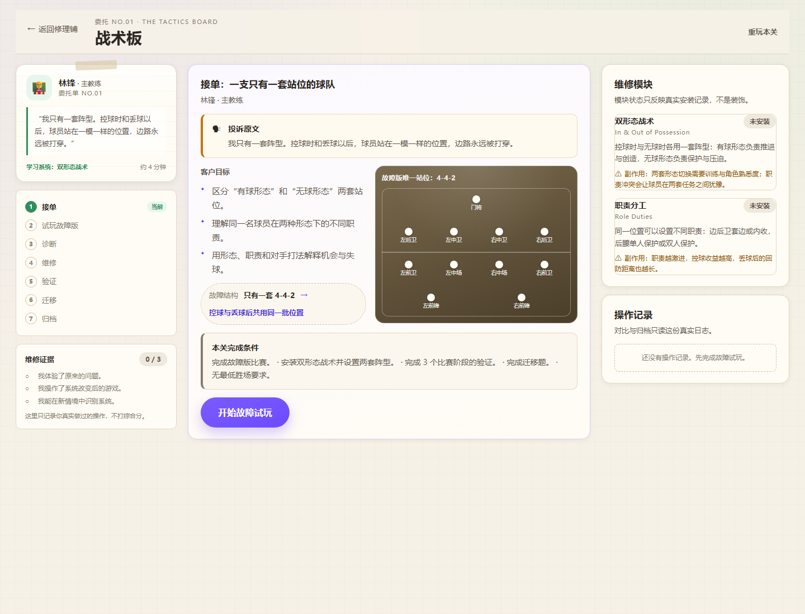
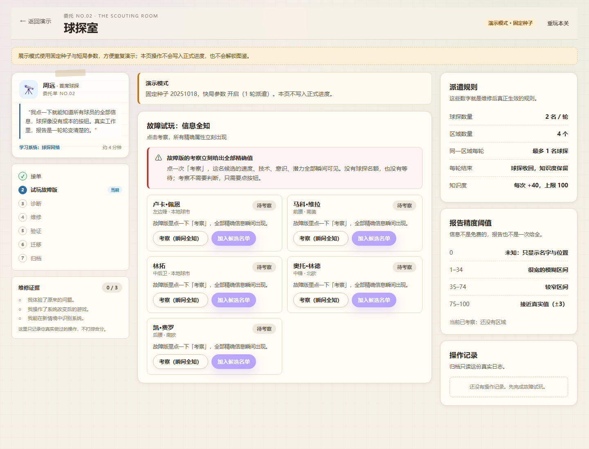
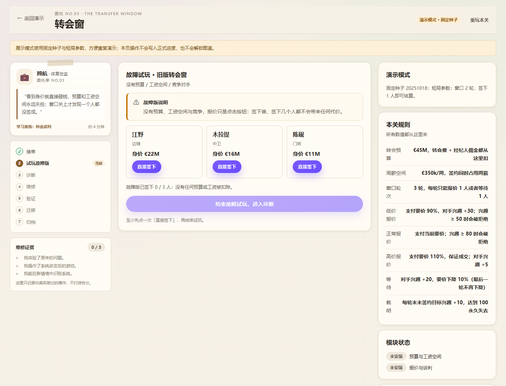
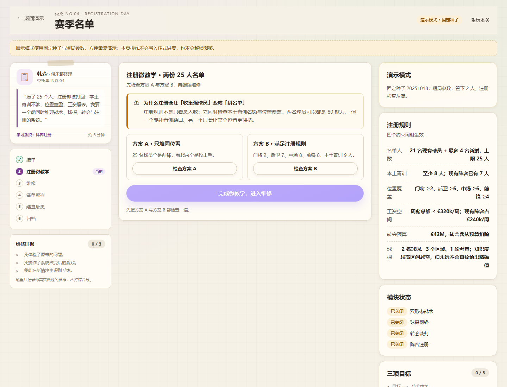

# 经理修理铺

> 把不好玩的足球经理，修成有选择的足球经理。

一个可以直接在浏览器里玩的足球经理教学游戏。你扮演俱乐部系统修理工：先试玩一个坏掉的俱乐部系统，再亲手安装战术、球探、转会与注册规则，调整参数、再次试玩，用真实的比赛记录、球探报告和注册名单理解「规则怎样改变选择」。

- 技术栈：React 19 + TypeScript + Vite，Vitest 做规则测试。
- 无后端、无付费 API、无密钥、无外部图片 CDN；进度保存在浏览器 localStorage。
- **非官方作品**：灵感来自足球经理类游戏的公开功能介绍，不使用真实俱乐部、球员或教练名称，数值为原创简化原型，与 Sports Interactive、Sega 或《Football Manager》系列无隶属关系。

---

## 界面预览

> 预览截图在 `docs/screenshots/`，使用生产构建 + 无头 Chrome 截取，见「验收记录」。

| 主页 | 关卡一 · 战术板 |
| --- | --- |
|  |  |

| 关卡二 · 球探室 | 关卡三 · 转会窗 |
| --- | --- |
|  |  |

| 毕业关 · 赛季名单 | 经理图鉴 |
| --- | --- |
|  |  |

---

## 快速开始

需要 Node.js 22+（Vite 7 要求 Node 20.19+ / 22.12+；开发时使用 Node 24）。

```bash
pnpm install
pnpm dev        # 开发服务器，默认 http://localhost:5173
```

生产构建与预览：

```bash
pnpm build      # tsc --noEmit && vite build，产物在 dist/
pnpm preview    # 本地预览生产构建
```

> `pnpm-workspace.yaml` 里的 `allowBuilds: esbuild` 用于允许 esbuild 运行安装脚本，`pnpm install` 应正常结束（退出码 0）。

---

## 已实现功能

### 全局
- 修理铺主页：标题与说明、开始/继续维修、四张委托卡、进度条、经理图鉴入口、展示模式入口、设置与存档入口。
- 委托卡状态：未开始 / 进行中 / 已完成 / 未解锁；正常模式按顺序解锁，展示模式可直接访问全部关卡。
- 关卡工作台：桌面端三栏（委托与步骤 / 游戏台 / 规则与操作记录），窄屏上下排列，游戏台优先显示。
- 共用维修面板、模块卡、诊断/迁移题卡、事件日志、对比表格、维修证据面板。
- 四张经理图鉴卡（双形态战术 / 球探网络 / 转会谈判 / 阵容注册），带解锁与未解锁状态。
- 本地进度保存：关卡状态、完成记录、图鉴解锁、设置；坏档与版本不兼容安全回退并提示。
- 一键重玩当前关卡、重置全部进度（带确认）。
- 减少动态效果设置，尊重系统 `prefers-reduced-motion`。
- 事件日志记录每次合法操作的 before/after 与收益/损失，对比与结算只读真实日志。
- 可序列化、可设种子的伪随机数；同种子同动作序列结果一致，存档恢复后随机序列连续。
- 展示模式：8 步固定种子演示，可跳步、可重置，不写正式进度。
- 非官方声明与创作边界页（设计参考）。

### 关卡一：战术板（双形态战术）
- 客户：主教练林锋。投诉：一套阵型同时管控球与无球，边路反复被打穿。
- 故障试玩：固定 4-4-2 打 3 个比赛阶段，每阶段可以喊「压上 / 平衡 / 回收」，但只有一套站位，指令改变不了结构。
- 诊断：为什么单一阵型不行 → 控球与无球需要两套不同站位与职责。
- 第一次维修：安装「双形态战术」，分别选择有球/无球阵型，用指标条看到推进、边路保护、中路保护与体能的取舍。
- 第二次维修：安装「职责分工」，选择边后卫与后腰职责，继续改变指标与代价。
- 验证：面对固定倾向的对手打 3 个比赛阶段，每阶段做一次阶段指令，真实记录机会、失球与边路丢球。
- 迁移：在另一支球队的情境中识别有球形态 / 无球形态 / 职责分工三个组成。
- 归档：真实对比故障版与修复版，给出规则、决策与代价三条总结。

### 关卡二：球探室（球探网络）
- 客户：首席球探周远。投诉：点一下就知道所有信息，球探像无限按钮。
- 故障试玩：5 名候选，无限次「考察」瞬间显示精确属性，挑选毫无信息成本。
- 诊断：为什么考察没有意义 → 有限球探 + 信息逐步变清楚。
- 维修：安装「有限球探」（2 名球探、4 个区域、每区域每轮最多 1 人、轮末收回）与「知识度报告」（知识度分级解锁属性区间）。
- 验证：2 轮派遣，每轮派 2 名球探到不同区域，轮末看知识度与报告变化；2 轮后只能依据当前报告选 1 名候选。
- 迁移：在三个情境中识别「有限球探 + 区域容量 + 轮末收回 + 信息积累」的结构。
- 归档：真实派遣记录、知识度与选择结果。

### 关卡三：转会窗（转会谈判）
- 客户：体育总监顾航。投诉：看到身价就砸钱，预算与工资空间失控，窗口关了还没签成人。
- 故障试玩：3 名候选可直接签下，没有预算、工资与竞争限制。
- 诊断：为什么报价没有意义 → 缺少预算、工资空间与竞争风险等代价。
- 维修：安装「预算与工资空间」与「报价与谈判」；3 轮窗口内用低价/正常/高价报价或等待，竞争对手兴趣会累积，窗口结束前至少签下 2 人。
- 验证：真实出价、签约、预算与工资使用、错过原因全部来自日志。
- 迁移：另一家俱乐部在「等更便宜」与「锁定目标」之间的取舍，识别预算/工资/竞争/窗口四个要素。
- 归档：真实签约记录、预算使用与三条总结。

### 毕业关：赛季名单（阵容注册 + 组合系统）
- 客户：俱乐部经理韩森。投诉：凑了 25 人却注册被打回：青训不够、位置重叠、工资爆表。
- 微教学：两种 25 人名单摆法，直观看到「注册规则让收集强球员变成拼一张能过关的名单」。
- 四个模块：双形态战术 / 球探网络 / 转会谈判 / 阵容注册，各有即时说明，正式名单流程开始后锁定，修改必须重开。
- 验证：有限球探考察候选（知识度不足只显示区间）→ 在预算/工资内签下 4 人 → 设置有球/无球形态并完成一次比赛阶段决策 → 注册检查（25 人、本土青训、位置覆盖、工资）。
- 结算：名单、预算与工资、注册检查表、三项目标证据、真实操作记录；未达标时给反事实计算题；最后从多条解释中选择「为什么注册规则会改变转会目标选择」，每条都有针对性反馈，不判唯一正确答案。
- 无最低积分要求，不显示虚假的好玩指数、平衡度或满意率。

---

## 目录结构与架构

```text
src/
  app/                 # 路由外壳、主页、设置、图鉴页、展示模式页、关卡页
    App.tsx            # 全局状态、hash 路由、进度持久化、模式切换
    AppContext.tsx     # useApp() 提供的上下文类型
    HomeScreen.tsx     # 修理铺主页与委托卡
    LevelPage.tsx      # 关卡顶栏 + 关卡组件挂载
    levelRegistry.tsx  # 关卡 id → 组件
  components/          # 通用界面（纯展示/交互，不含规则）
    Ui.tsx             # Button/Panel/Chip/Callout/StatTile/RiskMeter/Toggle/Dialog 等
    Workbench.tsx      # 三栏工作台、委托单、步骤轨、维修证据
    ModulePanel.tsx    # 模块卡与参数预设
    QuizCard.tsx       # 诊断/迁移题，允许重试、显示解释
    EventLogView.tsx   # 事件日志与对比表格
  game/
    engine/            # 纯规则基础设施
      types.ts         # LevelId / LevelPhase / Evidence / EventLogEntry / LevelScreenProps
      rng.ts           # 可序列化 mulberry32 随机数
      events.ts        # 事件日志追加与工具
    levels.ts          # 四关元数据、解锁顺序、系统名称
    progressOps.ts     # 完成关卡的纯函数（正常/展示模式）
    levels/tactics/    # 关卡一：logic.ts + TacticsLevel.tsx + tactics.css
    levels/scouting/   # 关卡二：logic.ts + ScoutingLevel.tsx + scouting.css
    levels/transfers/  # 关卡三：logic.ts + TransfersLevel.tsx + transfers.css
    levels/squad/      # 毕业关：logic.ts + SquadLevel.tsx + squad.css
  content/             # 经理图鉴、展示模式步骤与文案
  storage/
    persistence.ts     # localStorage 读写、schema 校验、坏档回退
  styles/
    global.css         # 设计变量、基础布局与共享组件样式
tests/                 # 规则单测 + 用户流程冒烟测试
docs/screenshots/      # 验收截图
```

设计原则：

- **规则与界面分离**：每关 `logic.ts` 是纯函数状态机，不依赖 React / DOM / 当前时间；组件只负责渲染与派发动作。规则可以单测，同种子同动作可复现。
- **事件日志是唯一事实来源**：对比面板、结算数据只读日志与状态，不生成临时统计。
- **单一可序列化关卡状态**：每关用 `useEffect` 把整个状态交给 App 持久化；`savedState` 经过类型守卫恢复，损坏则从头开始。
- **完成关卡是纯函数**：`applyLevelCompletion` 处理正常模式解锁与展示模式不写正式进度的差异，便于单元测试。
- **共享 UI 不重复造轮子**：四关复用同一套面板、模块卡、题卡与日志组件；关卡专属样式用各自前缀，避免互相覆盖。

---

## 规则参数集中位置

| 内容 | 文件 |
| --- | --- |
| 关卡元数据、可用模块、完成条件、解锁顺序 | `src/game/levels.ts` |
| 战术板：阵型/职责指标、对手倾向、阶段结果 | `src/game/levels/tactics/logic.ts` |
| 球探室：球探数、区域数、知识度增长与阈值 | `src/game/levels/scouting/logic.ts` |
| 转会窗：预算/工资、报价档位、竞争兴趣、轮次 | `src/game/levels/transfers/logic.ts` |
| 赛季名单：注册人数/青训/位置覆盖、预算、反事实题 | `src/game/levels/squad/logic.ts` |
| 经理图鉴文案 | `src/content/codex.ts` |
| 展示模式步骤与固定种子 | `src/content/showcaseSteps.ts` |
| 存档 key、schema 版本、默认进度 | `src/storage/persistence.ts` |

这些数值都是可调的原型参数，用于让系统差异在几分钟内被看见，不代表任何商业游戏的实际规则或真实比赛结果。

---

## 测试与检查

```bash
pnpm test        # vitest run，一次性运行全部测试
pnpm typecheck   # tsc --noEmit
pnpm build       # 类型检查 + 生产构建
```

测试文件：

- `tests/tactics.test.ts`：单一阵型 vs 双形态指标、阶段结果、证据标记、非法操作、同种子一致、存档恢复、UI 冒烟。
- `tests/scouting.test.ts`：球探消耗与区域容量、轮末重置、知识度增长/上限/阈值、报告精度、非法派遣、UI 冒烟。
- `tests/transfers.test.ts`：预算/工资双约束、报价档位、等待与竞争、截胡、窗口结束、完成判定、UI 冒烟。
- `tests/squad.test.ts`：注册规则、每人只占一次名额、目标证据、反事实题、模块退化、重开、UI 冒烟。
- `tests/codex.test.ts`：四张卡完整、机制覆盖、名称与元数据一致。
- `tests/storage.test.ts`：保存/读取 roundtrip、损坏 JSON 回退、版本不兼容回退、存储不可用回退、清空存档、非法数据清洗。
- `tests/progress.test.ts`：正常完成解锁图鉴与下一关、重复完成幂等、展示模式不写正式进度、解锁顺序、演示进度去重。
- `tests/app-flow.test.tsx`：主页 → 第一关 → 故障试玩 → 保存/恢复；展示模式不影响正式进度；按顺序解锁毕业关；设置页重置进度；30 秒体验入口。

### 本次实际运行过的检查（2026-10-18）

| 检查 | 命令 / 方式 | 结果 |
| --- | --- | --- |
| 安装依赖 | `pnpm install` | 退出码 0（pnpm 11，esbuild 构建脚本已允许） |
| 类型检查 | `pnpm typecheck`（`tsc --noEmit`） | 0 错误 |
| 自动化测试 | `pnpm test`（`vitest run`） | 8 个测试文件 / **136 个测试全部通过** |
| 生产构建 | `pnpm build` | 成功，产物 `dist/`（JS 455.20 kB / gzip 139.63 kB，CSS 60.89 kB / gzip 10.60 kB） |
| 生产预览 + 无头浏览器 | `pnpm preview` + Chrome CDP | 主页、四关、图鉴、展示模式均可打开，无控制台错误 |
| 响应式检查 | 无头 Chrome 在 1440 / 768 / 390 宽度 | 页面无横向滚动（`scrollWidth = innerWidth`），窄屏布局正常 |
| 正常模式端到端 | 无头浏览器自动点击战术板全流程 | 故障版 → 诊断 → 两次维修 → 3 个比赛阶段 → 迁移 → 归档；localStorage 写入 schema v2，完成记录 `["tactics"]`，第二关与图鉴解锁 |
| 展示模式端到端 | 无头浏览器从演示页跳转到战术板 | 固定种子 20251018、短局 2 阶段、页面标注「演示模式 · 固定种子」，正式存档未创建 |

Playwright 未安装、未执行；用户流程由 Vitest + Testing Library 的 DOM 冒烟测试与无头浏览器检查替代。所有检查只证明当前环境下的行为，不代表真实用户研究结论。

---

## 约 5 分钟演示路线

1. 打开主页，读一句定位：「先试玩坏掉的系统，再亲手改规则」。
2. 点「30 秒体验战术板」：用固定 4-4-2 打 3 个比赛阶段，看到「只有一套站位」的问题。
3. 诊断：选择「控球和无球需要两套不同站位与职责」。
4. 安装双形态：设置有球 4-3-3 / 无球 4-4-2 中位块，再设置边后卫与后腰职责。
5. 打 3 个比赛阶段：观察边路保护与机会变化，查看故障版 vs 修复版对比。
6. 完成迁移题，归档，解锁「双形态战术」图鉴卡。
7. 打开「展示模式」，从第 6 步直接看球探室与转会窗示例，再进毕业关看四个系统一起影响名单，最后打开经理图鉴。

---

## 已知限制与取舍

- **没有后端 / 账号 / 云同步**：进度只在本机浏览器；清除浏览器数据会丢失进度。
- **不是商业足球经理模拟器**：比赛、球探、转会与注册都是原创简化模型，不追求真实联赛赛程、真实数据库或完整财政系统，也不代表《Football Manager》的实际规则。
- **参数是原型参数**：没有平衡性验证，也不宣称「已经好玩」；所有对比数字来自本次真实操作。
- **展示模式不持久化**：演示步骤与演示完成记录只存在当前页面内存，刷新即重置；这是为了不污染正式进度。
- **没有音效**：首版未实现音效，避免默认依赖声音传递信息。
- **Playwright 未执行**：环境未安装浏览器自动化依赖；用 Vitest + Testing Library 冒烟测试与 Chrome CDP 检查替代。
- **同种子复盘**：重玩本关会生成新种子；同规则、同种子的确定性由单元测试覆盖，但界面没有单独提供「原种子复盘」按钮（首版取舍）。
- 展示模式的迁移/反思步骤可跳过并标注「演示跳过迁移题」，跳过后 evidence.transferred=false，不计正式完成。

---

## 设计决定（任务书未明确规定处的选择）

- **题材映射**：足球经理的系统被拆成四关——战术（双形态战术）、球探（有限球探 + 知识度）、转会（预算 + 谈判 + 竞争）、注册（人数 + 青训 + 位置覆盖）。毕业关把它们组合成一个名单任务。
- **教学闭环**：每关保留任务书式的 接单 → 故障试玩 → 诊断/微教学 → 维修 → 验证 → 迁移/反思 → 归档；完成只看三个维修证据，不设最低胜场/高分。
- **数据真实性**：比赛、球探报告、转会记录与注册检查全部来自本地状态与事件日志，不生成假统计。
- **虚构内容**：所有俱乐部、球员、教练均为原创虚构名称；不使用真实队徽、球员照片或商业游戏素材。
- **存档结构**：`manager-repair-shop.progress.v2` 与 `manager-repair-shop.settings.v1`；版本不兼容或 JSON 损坏时回退默认进度并提示。
- **路由**：hash 路由（`#/level/tactics` 等），无需服务端配置，静态托管即可运行。

---

## 设计参考与声明

系统的选题方向参考了《Football Manager 26》官方公开的功能介绍（双形态战术、比赛日、球探、转会、国际管理等），参考地址：footballmanager.com/fm26/features。本项目只使用自行撰写的原创中文表述、原创俱乐部与球员、原创简化规则，没有复制其界面、图标、文本、数据库或规则表。

本项目是独立、非官方的教学原型，与 Sports Interactive、Sega 或《Football Manager》系列没有隶属关系，也未获得作者、发行方或任何俱乐部的授权、推荐或背书。游戏内所有对比数据来自玩家本地操作记录，不含虚构用户数据、好玩指数、平衡度百分比或满意率。
